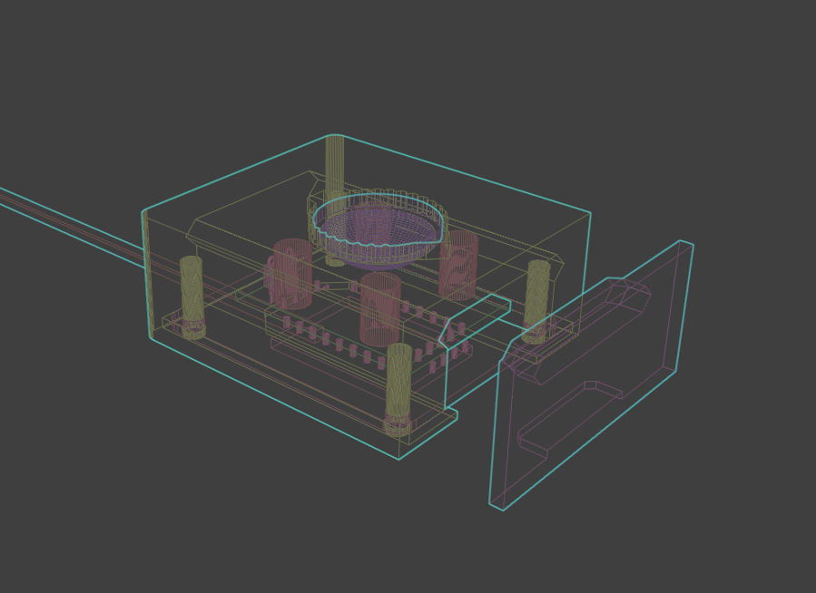

# 外壳 3D 设计

本目录提供 TCS3200 Sensor Kit 的外壳设计源文件和预览图。

## 文件

- [TCS3200-3D.blend](TCS3200-3D.blend)：Blender 设计源文件，用于查看和修改外壳。
- [TCS3200-3D.png](TCS3200-3D.png)：设计预览图。

## 使用与修改

使用 Blender 打开 `.blend` 文件。制作外壳前，按实际传感器模块、RP2040-Zero 和 PCB 核对尺寸、安装位置与接口开口，再导出所需的加工或打印格式。

修改安装结构时，结合 [PCB 设计](../layout/README.md) 检查配合关系。测量时固定传感器与屏幕的距离和角度，并遮挡环境光；实际工作照片见 [项目首页](../README.md#屏幕采样实拍)。
