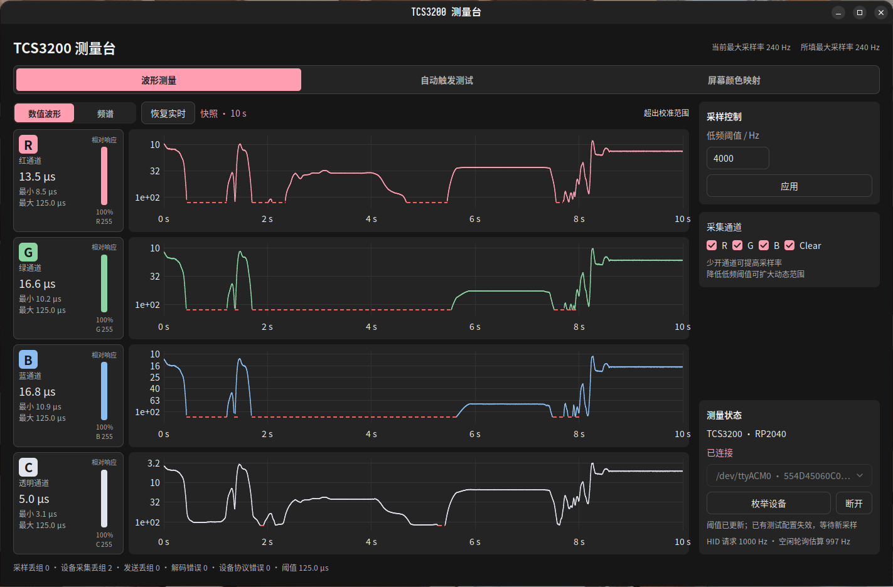
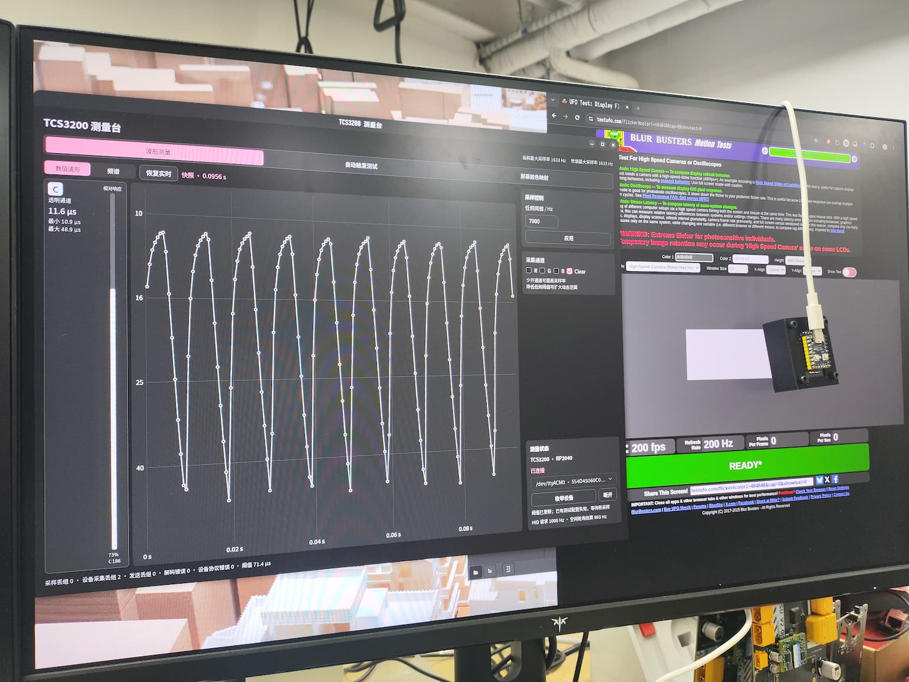
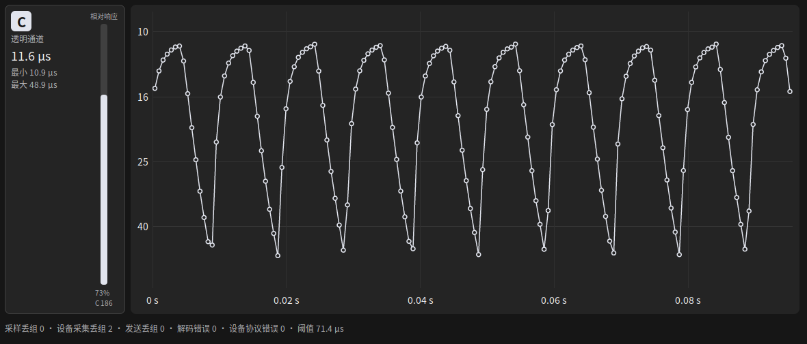
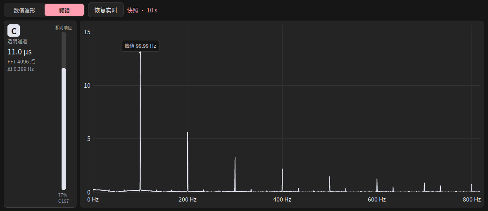
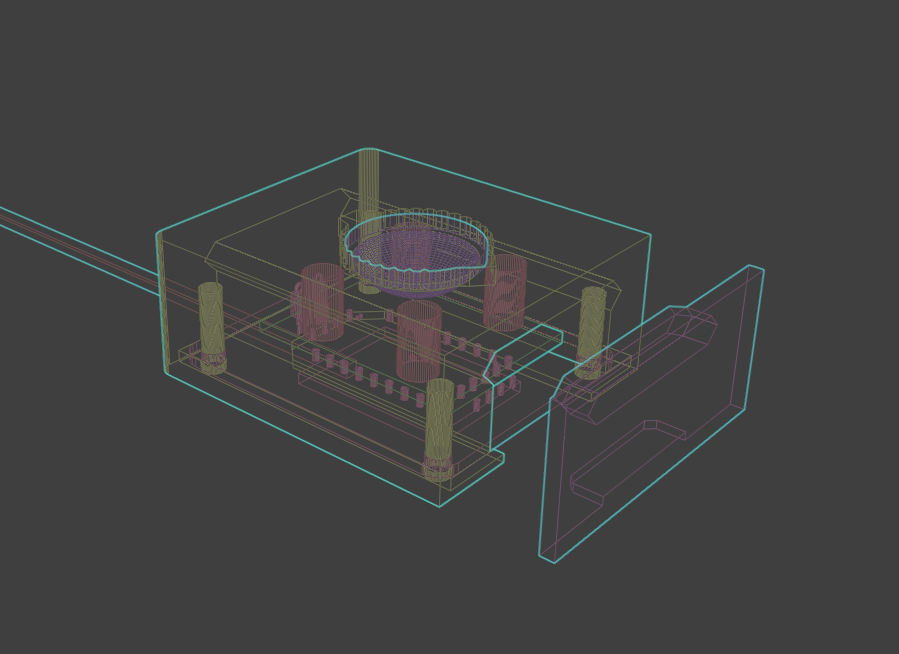
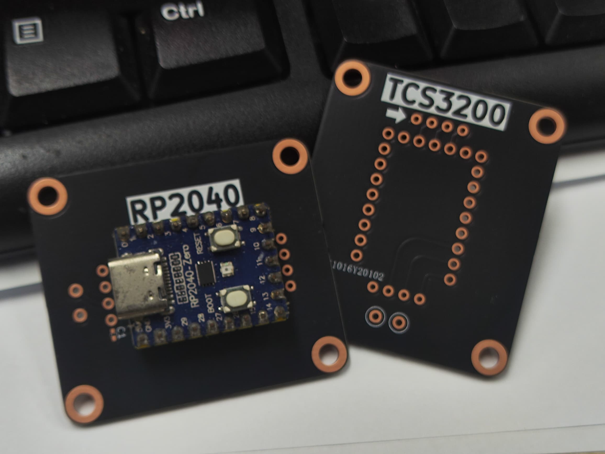

# TCS3200 Sensor Kit
[](https://awesomemygo.dev/apps/tcs3200-sensor-kit)

TCS3200 Sensor Kit 使用 TCS3200 传感器和 RP2040-Zero 采集屏幕光信号，在 Linux 上位机中查看 R/G/B/Clear 四通道波形、建立传感器读数与屏幕 RGB 值的映射，并测试颜色变化后的延迟点击。仓库包含固件、上位机、外壳 3D 设计和 PCB 设计。

## 软件与实测

### 上位机界面



上位机提供波形测量、自动触发测试和颜色校准。波形保留最近 10 秒，支持缩放、暂停快照，以及像素时间桶的 Max/Min/中位数统计。

> **特别说明：** 软件中的颜色校准功能仅用于建立传感器读数与屏幕 RGB 值的映射，不能用于校准屏幕本身的颜色。

### 屏幕采样实拍



实拍条件：屏幕刷新率 **200 Hz**，采样率 **1633 Hz**，采样页面为 UFO Test。

| 数值波形 | 频谱（FFT） |
| --- | --- |
|  |  |

数值波形与频谱截图对应上方实拍中的采样。

## 外壳与 PCB

### 外壳 3D 设计



使用 Blender 打开 [TCS3200-3D.blend](3D/TCS3200-3D.blend) 编辑外壳。文件说明见 [3D 目录](3D/README.md)。

### PCB 设计



使用 KiCad 打开 [TCS3200-TB.kicad_pro](layout/TCS3200-TB.kicad_pro) 查看原理图与 PCB。文件说明见 [layout 目录](layout/README.md)。

## 快速开始

### 编译与刷写固件

按 [固件接线说明](firmware/README.md#接线) 连接传感器。关闭模块照明 LED，固定传感器与屏幕的距离和角度，并遮挡环境光。RP2040 GPIO 使用 3.3 V 电平；若模块以 5 V 供电，OUT 必须经过电平转换。

在仓库根目录运行：

```sh
make       # 使用 xianii/pico-sdk:2.3.0 Docker 镜像编译
make test  # 主机 C 自检（ASan/UBSan）及 PIO 时序模拟；需要 cc 和 Python 3
```

输出：`firmware/build/src/tcs3200_sensor.uf2`。按住 BOOT 接入 USB，复制 UF2 到引导盘。详细接线与验证见 [固件说明](firmware/README.md)，上位机开发以 [协议 v4](docs/protocol.md) 为准。

### 启动 Linux 上位机

```sh
make host          # 实际设备界面；手动枚举、选择、连接
make host-demo     # 无硬件合成信号演示
make host-build    # host/build/tcs3200-host
make host-test     # 上位机测试和 vet
```

需要 Go 1.27.3+、GTK 3 与 OpenGL。连接设备后点击“枚举设备”，选择端口并连接。没有硬件时可先运行演示模式。串口权限、图表操作、自动触发与颜色映射步骤见 [上位机说明](host/README.md)。

## 采样与触发

固件通过 PIO 测量传感器输出周期，经 USB CDC bulk 传输原始频率；上位机按 50% 占空比换算为脉宽（μs）。RGB+C 可独立开关，低频阈值范围为 100～600000 Hz。启用通道数和低频阈值共同决定最大计划组频率，非空采集为 6～4000 Hz，全关为 0。默认四通道、15 kHz 阈值对应最大 814 Hz。

各通道按顺序采集，并非同时测量。低频或超时通道置零并标记 LOW；屏幕 PWM、刷新和通道间时间偏移会影响颜色判定。

自动触发测试先采集 ARM 参考色，偏离后由 MCU 计时并发送 HID 动作。上位机支持单次或连续左键测试，固件协议还支持键盘和鼠标按钮配置。LOW 无法区分黑屏与传感器断线；USB 轮询和系统调度会增加最终动作延迟，使用前需按实际屏幕和安装条件校准。

## 目录与开发

| 目录 | 内容 |
|---|---|
| [firmware/](firmware/README.md) | Pico SDK + TinyUSB 固件、PIO、接线与上板验证 |
| [host/](host/README.md) | MyGo 原生 Linux 上位机、图表、触发测试与颜色校准 |
| [3D/](3D/README.md) | Blender 外壳设计源文件与预览 |
| [layout/](layout/README.md) | KiCad 工程、原理图、PCB 与预览 |
| [docs/](docs/README.md) | USB 协议与界面、实测图片 |

固件与上位机使用 [USB 二进制协议 v4](docs/protocol.md)，须配套升级。修改协议字段、单位或行为时，同步更新两端实现、协议文档与测试。

## 来源与许可

项目基于 [Nigh/pico-cdc-hid-template](https://github.com/Nigh/pico-cdc-hid-template) 建立，保留 [MIT 许可](LICENSE)。HID 提供键盘和鼠标功能，CDC 用于二进制采样与控制。
