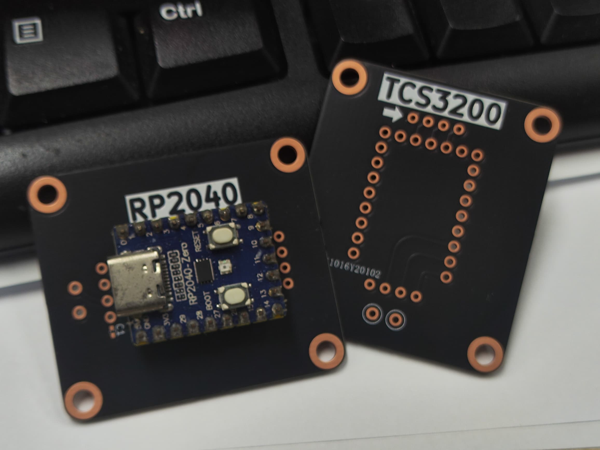

# PCB 设计

本目录提供 TCS3200 Sensor Kit 的 KiCad 工程、原理图和 PCB 布局。设计文件由 KiCad 10.0 生成。

## 文件

- [TCS3200-TB.kicad_pro](TCS3200-TB.kicad_pro)：KiCad 工程入口。
- [TCS3200-TB.kicad_sch](TCS3200-TB.kicad_sch)：原理图。
- [TCS3200-TB.kicad_pcb](TCS3200-TB.kicad_pcb)：PCB 布局。
- [PCB.jpg](PCB.jpg)：PCB 预览图。

## 使用与修改

使用 KiCad 10.0 或支持该文件格式的版本打开 `.kicad_pro`，进入原理图或 PCB 编辑器。制板前运行电气规则检查（ERC）和设计规则检查（DRC），核对封装、板框、连接与制造要求，再导出生产文件。

连接定义见 [固件接线说明](../firmware/README.md#接线)。修改 GPIO 分配时，同步更新 `firmware/src/sensor.h` 和接线表；调整板形或接口位置时，核对 [外壳设计](../3D/README.md)。

RP2040 GPIO 使用 3.3 V 电平。若传感器模块需要 5 V 供电，OUT 必须经过电平转换，不能直接接入 GPIO；模块照明 LED 保持关闭。
